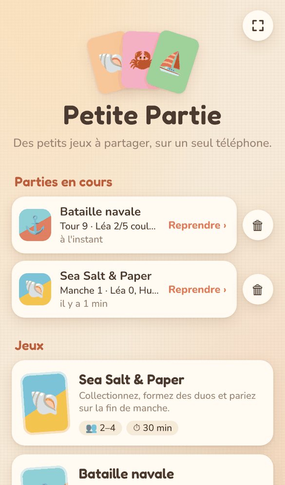
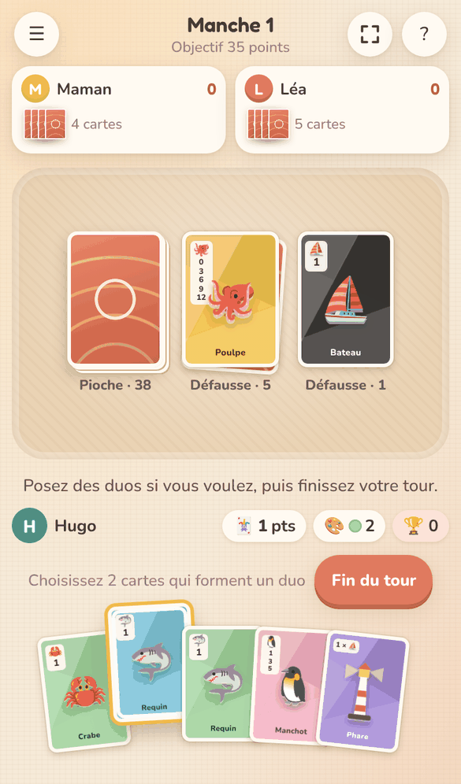
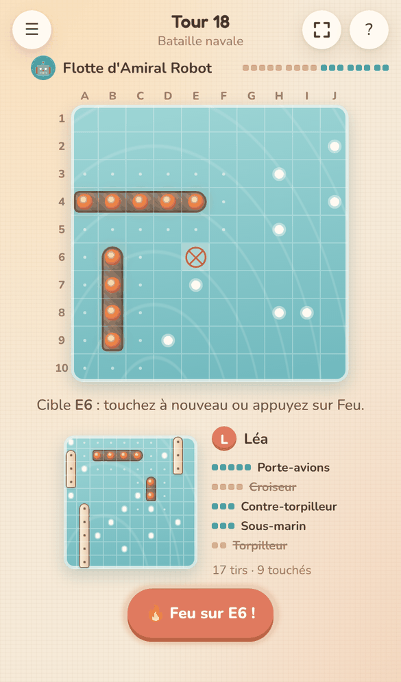
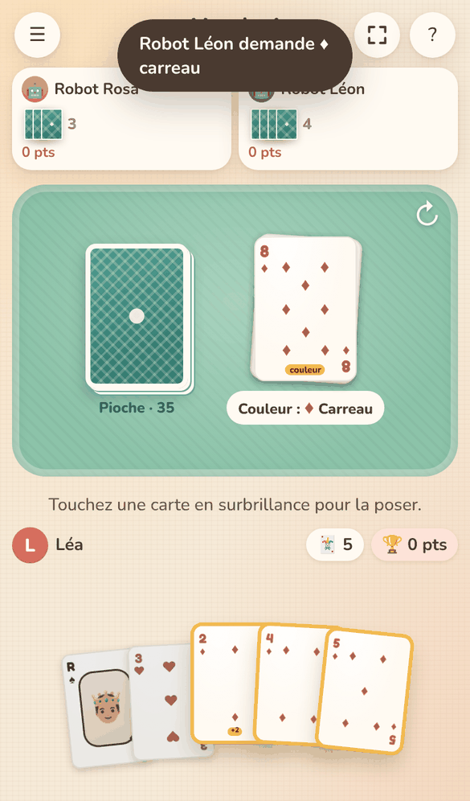

# Petite Partie 🃏

Des petits jeux à partager **sur un seul téléphone** : chacun joue à son tour puis passe le téléphone au suivant.
Application web pensée pour le navigateur mobile, sans installation (elle peut aussi être ajoutée à l'écran d'accueil).

**▶ Jouer : https://bertrandg.github.io/Game-cards/**

<table>
  <tr>
    <th>Accueil</th>
    <th>Sea Salt &amp; Paper</th>
    <th>Bataille navale</th>
    <th>Huit américain</th>
  </tr>
  <tr>
    <td></td>
    <td></td>
    <td></td>
    <td></td>
  </tr>
</table>

## Ce que fait l'application

- **Menu des jeux** : Sea Salt & Paper, la Bataille navale, le Huit américain et le Président ; d'autres viendront s'ajouter.
- **Joueurs enregistrés** sur le téléphone (nom, couleur, victoires par jeu).
- **Parties en cours sauvegardées automatiquement** après chaque action : on peut fermer le navigateur et reprendre plus tard.
- **Passage du téléphone** : avant chaque tour, un écran cache tout et annonce le prochain joueur, avec un résumé de ce qui s'est passé depuis son dernier tour.
- **Cartes animées** : elles glissent et se retournent quand on pioche, défausse, pose un duo ou vole une carte.

Tout est stocké dans le navigateur (`localStorage`) : rien n'est envoyé sur internet.

## Jeux

### Sea Salt & Paper (2 à 4 joueurs)

Règles complètes du jeu de base (58 cartes) :
- piocher 2 cartes et en défausser une, ou prendre le dessus d'une défausse ;
- duos : crabes (fouiller une défausse), bateaux (rejouer), poissons (piocher), requin + nageur (voler une carte) ;
- collections (coquillages, poulpes, manchots, moussaillons), multiplicateurs (phare, banc de poissons, colonie, capitaine), sirènes et bonus couleur ;
- fin de manche à partir de 7 points : **STOP** ou **Dernière chance** ; victoire immédiate avec les 4 sirènes ;
- fin de partie à 40 / 35 / 30 points selon le nombre de joueurs.

Les règles résumées et le détail des cartes sont accessibles en jeu avec le bouton **?**. Un appui long sur une carte l'affiche en grand.

### Bataille navale (1 ou 2 joueurs)

Règles classiques du « Touché Coulé », avec une variante maison :
- grille de 10 × 10 (colonnes A à J, lignes 1 à 10) et 5 navires droits : porte-avions (5), cuirassé (4), croiseur (3), sous-marin (3), torpilleur (2) ;
- les navires peuvent se toucher, mais pas se chevaucher ;
- on annonce « dans l'eau », « touché » ou « touché-coulé » en nommant le navire coulé ; le premier qui coule les 5 navires adverses gagne ;
- **variante : touché = on rejoue**, jusqu'à tomber dans l'eau ;
- placement par glisser-déposer, bouton « Tourner » et placement au hasard ;
- on vise une case puis on tire (deuxième appui ou bouton « Feu ») : boulet, plouf ou explosion, navire qui sombre ;
- à deux, on se passe le téléphone quand un tir tombe dans l'eau ; le joueur suivant voit la liste des tirs reçus et les revoit sur sa flotte ;
- seul, on affronte l'**Amiral Robot**, qui traque les navires touchés et estime où se cachent les autres.

### Huit américain (1 à 5 joueurs)

Avec un jeu classique de 52 cartes :
- 7 cartes chacun à deux, 5 cartes à partir de trois ;
- on pose une carte de la même couleur ou de la même valeur que celle du dessus de la défausse, sinon on pioche (et on peut poser la carte piochée si elle convient) ;
- **8** : change la couleur · **2** : le suivant pioche 2 cartes (cumulable avec un autre 2) · **valet** : le suivant passe son tour · **as** : changement de sens (à deux, on rejoue) ;
- celui qui n'a plus de cartes gagne la manche ; les autres marquent les points de leur main (8 = 50, figures = 10, as = 1, les autres leur valeur) ;
- la partie s'arrête quand un joueur atteint 100 points : le plus petit score gagne ;
- seul, on joue contre deux robots.

### Président (1 à 6 joueurs)

Avec un jeu classique de 52 cartes, toutes distribuées :
- ordre des valeurs : 3 < 4 < … < Roi < As < 2 ;
- on pose 1 à 4 cartes de même valeur ; les suivants posent le même nombre de cartes, de valeur égale ou supérieure, ou passent ;
- après une valeur égale, le joueur suivant doit poser cette valeur « ou rien » ; un 2 ferme le pli ;
- rôles par ordre de sortie : Président, Vice-président, Citoyens, Vice-pauvre, Pauvre ; à la manche suivante, le Pauvre donne ses 2 meilleures cartes au Président qui lui en rend 2 de son choix (1 carte entre les vices) ;
- 5 manches ; à chaque manche, le Président marque autant de points qu'il y a d'autres joueurs, puis un de moins à chaque place ;
- avec moins de 3 joueurs, des robots complètent la table (jusqu'à 4).

## Lancer en local

Les modules JavaScript doivent être servis en HTTP (ouvrir `index.html` directement ne marche pas) :

```bash
python3 -m http.server 8080
```

Puis ouvrir http://localhost:8080 (sur téléphone, même Wi-Fi : `http://<ip-de-l-ordinateur>:8080`).

## Mise en ligne

Le workflow `.github/workflows/pages.yml` publie le site à chaque push sur `main`.
À faire une fois : *Settings → Pages → Build and deployment → Source : GitHub Actions*.

## Structure

- `index.html`, `css/app.css`, `js/main.js` : la coque (accueil, joueurs, parties en cours, navigation par `#/…`)
- `js/storage.js` : joueurs, sauvegardes et historique dans le navigateur
- `js/ui/anim.js` : animations des cartes (technique FLIP + retournement 3D) et confettis
- `js/ui/dialog.js` : confirmations, saisie, messages
- `js/ui/sound.js` : bruitages générés en WebAudio — cartes, tirs, plouf, explosions (coupables depuis le menu du jeu)
- `js/cards/` : jeu de 52 cartes commun — `deck.js` (cartes, mélange, tri) et `render.js` (dessin des cartes) ; styles dans `css/deck.css`
- `js/ui/fullscreen.js` : bouton plein écran (masqué sur iPhone, où Safari ne le permet pas)
- `docs/` : captures d'écran du README
- `js/games/index.js` : registre des jeux
- `js/games/seasalt/` : Sea Salt & Paper — `cards.js` (les 58 cartes), `rules.js` (moteur de règles sans interface), `view.js` (table de jeu) ; styles dans `css/seasalt.css`
- `js/games/naval/` : Bataille navale — `rules.js` (moteur), `ai.js` (l'ordinateur), `view.js` (grilles et effets) ; styles dans `css/naval.css`
- `js/games/eights/` : Huit américain — `rules.js` (moteur), `ai.js` (les robots), `view.js` (table) ; styles dans `css/eights.css`
- `js/games/president/` : Président — `rules.js` (moteur), `ai.js` (les robots), `view.js` (table) ; styles dans `css/president.css`
- `css/app.css` contient aussi les éléments communs aux jeux (barre du haut, fenêtres, écran « passez le téléphone », règles)

## Ajouter un jeu

1. Créer `js/games/<id>/index.js` qui exporte par défaut :
   - `newGame(players)` → l'état de départ (un objet JSON, il est sauvegardé tel quel) ;
   - `summary(state)` → une ligne de résumé pour la liste des parties en cours ;
   - `mount(root, state, host)` → dessine le jeu dans `root` et renvoie `{ destroy() }`.
     `host` fournit `save(state)` (à appeler après chaque action), `finish({ winners, summary })`, `abandon()`, `exit()` et `restart(players)`.
2. L'inscrire dans `js/games/index.js` (nom, nombre de joueurs, emoji, couleurs de la tuile, feuille de style, `load` ; `solo` si le jeu se joue aussi seul contre l'ordinateur).
3. Le jeu n'est téléchargé qu'au moment où on le lance.

Noms de fichiers en minuscules, sans chiffres ni tirets (le versionnage du déploiement en dépend).

Sea Salt & Paper est un jeu de Bruno Cathala et Théo Rivière édité par Bombyx. Cette adaptation est un projet personnel : les cartes sont redessinées et ne reprennent pas les photos d'origine.
